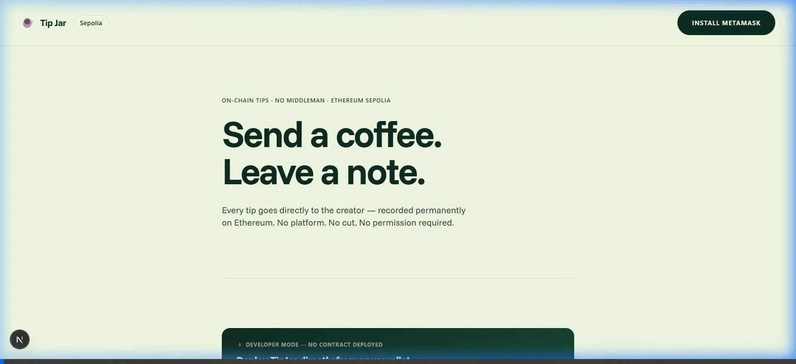

<p align="center">
    
</p>

<p align="center">
  <em>A decentralized tip jar where supporters send ETH directly to a creator with an optional message.</em>
</p>

<p align="center">
  <a href="https://tipit-dapp.vercel.app">Live Demo</a>
  |
  <a href="https://github.com/h55n/tipit">GitHub Repository</a>
</p>

<div align="center">


</div>

# :coffee: tipit

**tipit** is a decentralized tip jar for the MetaMask Community Builder Challenge · Pune. Every tip is recorded permanently on Ethereum — no platform, no cut, no middleman. The supporter wall reads directly from on-chain events, not a database.

---

## 🚀 Live Demo

Network: **Ethereum Sepolia Testnet**  
Frontend: [tipit-dapp.vercel.app](https://tipit-dapp.vercel.app)

---

## 🏗 Architecture

```text
tipjar/
├── contracts/
│   └── TipJar.sol          Solidity contract (payable tip, owner withdraw)
├── scripts/
│   └── deploy.js           Hardhat deploy script → writes frontend/deployment.json
├── test/
│   └── TipJar.test.js      Full test suite (13 tests)
├── hardhat.config.js
├── .env.example
│
└── frontend/               Next.js 14 app
    ├── app/
    │   ├── layout.tsx
    │   ├── page.tsx         Hero + TipForm + SupporterWall
    │   └── globals.css      Loops House design tokens
    ├── components/
    │   ├── WalletConnect.tsx  MetaMask connection + network switching
    │   ├── TipForm.tsx        Amount + message + transaction lifecycle
    │   ├── SupporterWall.tsx  On-chain event feed (queryFilter + live listener)
    │   └── DeployBanner.tsx   In-browser contract deployment via MetaMask
    └── lib/
        ├── contract.ts      ABI, address, ethers.js helpers
        └── events.ts        fetchAllTips() + subscribeTips()
```

---

## ⚡ Quick Start

### 1. Prerequisites

- Node 20+ (`node -v`)
- MetaMask browser extension
- A [QuickNode](https://www.quicknode.com/) free Sepolia endpoint
- Sepolia test ETH from a faucet ([Alchemy](https://www.alchemy.com/faucets/ethereum-sepolia) or [QuickNode](https://faucet.quicknode.com/ethereum/sepolia))

### 2. Install dependencies

```bash
# Root (Hardhat)
npm install

# Frontend (Next.js)
cd frontend && npm install
```

### 3. Run the frontend

```bash
cd frontend
npm run dev
```
Open `http://localhost:3000` — connect MetaMask on Sepolia and deploy your own TipJar contract directly from the browser! No `.env` or private keys required in the code!

---

## 📜 Smart Contract

**`contracts/TipJar.sol`**

```solidity
function tip(string calldata message) external payable
```
- Minimum tip: `0.0001 ETH`  
- Max message: `280 bytes`  
- Emits `NewTip(address sender, uint256 amount, string message, uint256 timestamp)`

```solidity
function withdraw() external  // owner only
```
- Transfers full balance to owner  
- Emits `Withdrawal(address to, uint256 amount)`

**Why events are the source of truth:**  
The supporter wall never uses local React state as the primary source. On mount, `queryFilter(filters.NewTip())` fetches all historical tips from the chain. A live listener (`contract.on("NewTip", ...)`) then appends new tips in real time. If you refresh the page, you see the same wall — because it's reading Ethereum, not a server.

---

## ✨ Features

| Feature | Implementation |
|---|---|
| In-Browser Deploy | Deploy the contract directly from MetaMask, no private keys in `.env` |
| Wallet connect | `eth_requestAccounts` via `window.ethereum` |
| Network check | Detects chainId, prompts `wallet_switchEthereumChain` |
| Tip form | Preset amounts + custom input + message with live byte counter |
| Transaction lifecycle | idle → pending (with Etherscan link) → confirmed / failed |
| Supporter wall | `queryFilter` historical events + live `contract.on` listener |
| Error handling | User rejection, wrong network, failed tx, MetaMask not installed |

### Local contract regression tests

At the repository root, run `npm ci` followed by `npm test`. This runs the
TipJar suite on Hardhat's disposable in-process network explicitly, regardless
of any configured public RPC. It does not use a wallet, deploy to Sepolia or
spend real funds. No environment file or API key is needed. `npm run compile`
compiles the contracts without deploying them. CI runs this same suite on
Node 22 and 24; the frontend is a separate project under `frontend/`.
